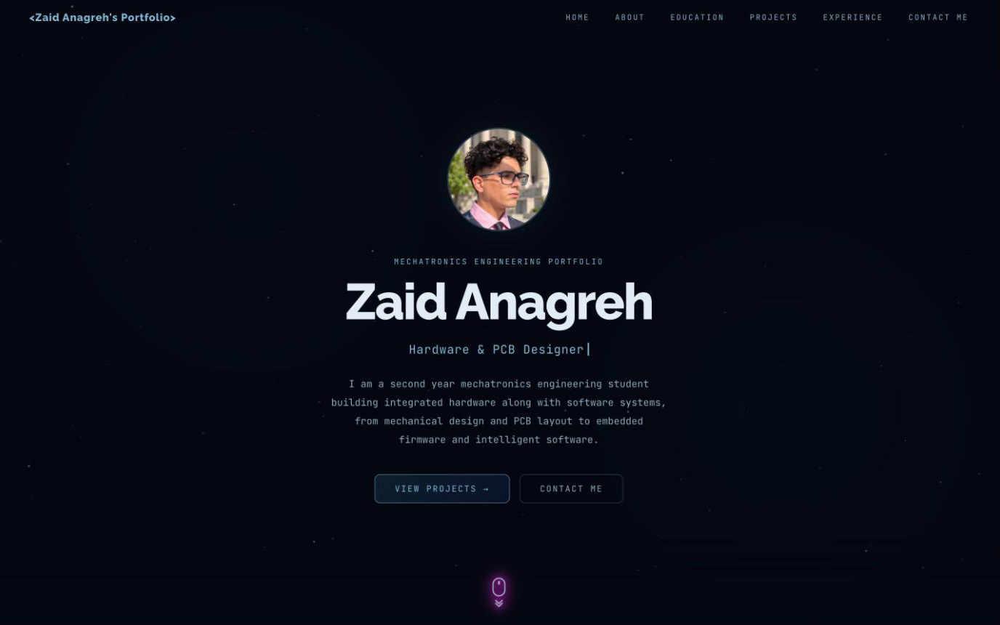
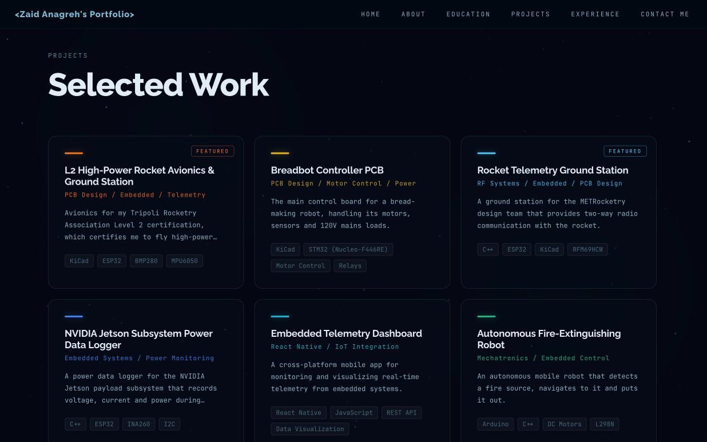
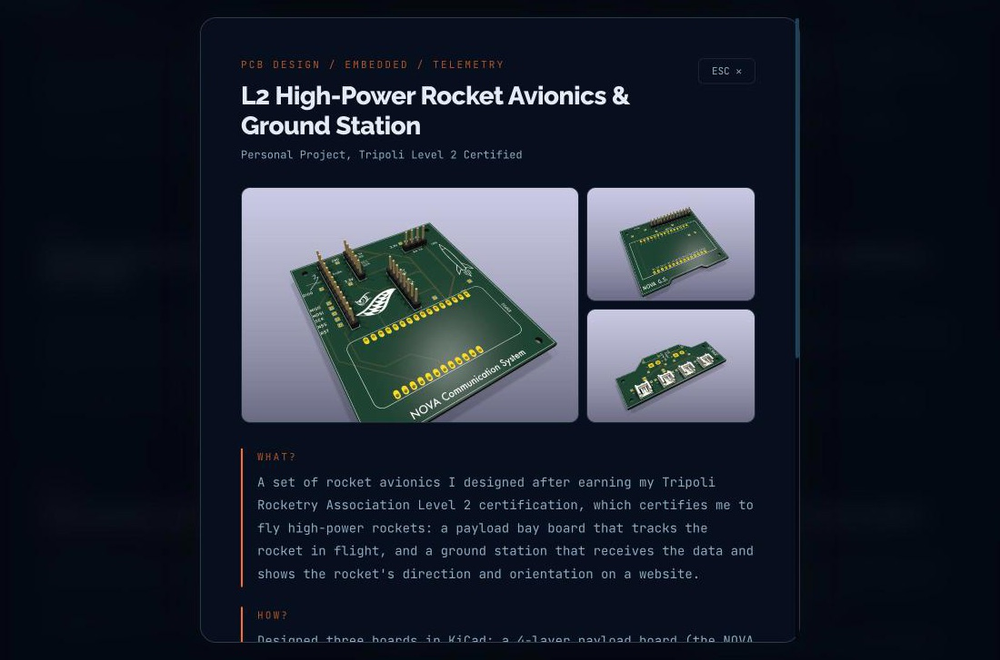
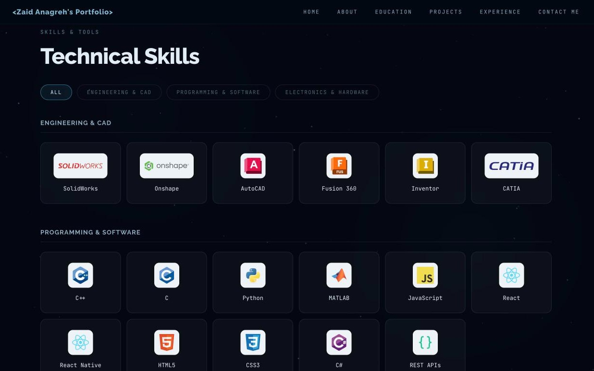
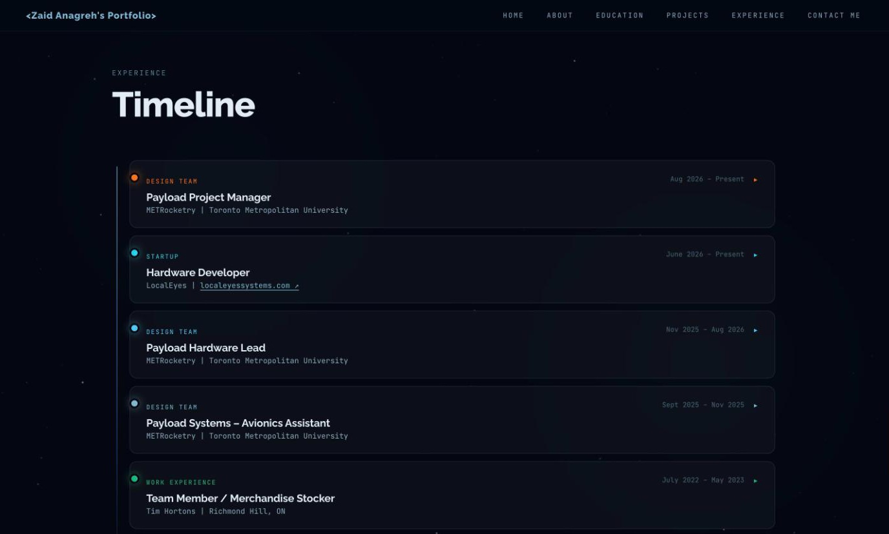
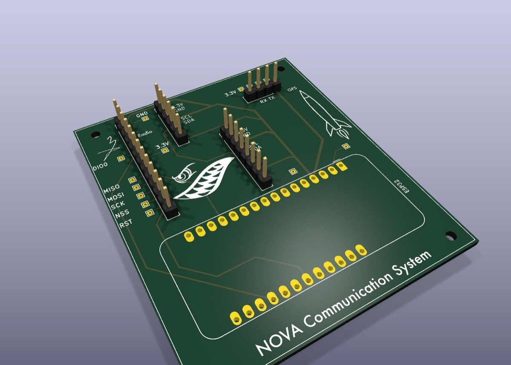
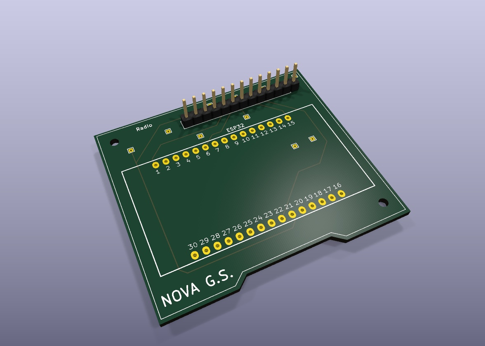
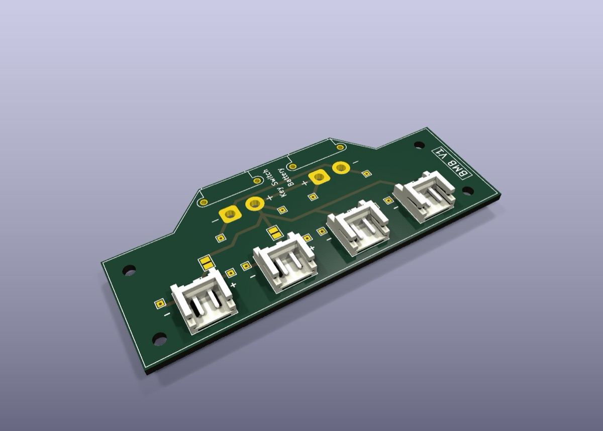
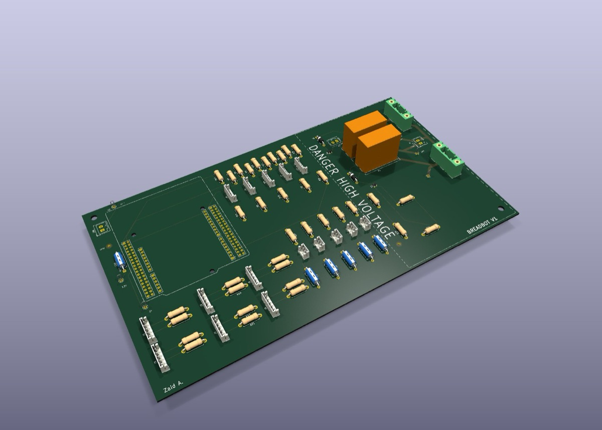

<div align="center">

# Interactive Portfolio

**Mechatronics Engineering student at Toronto Metropolitan University: PCBs, embedded firmware, CAD and the software that ties them together.**

[](https://zaid-anagreh.vercel.app/)


*The interactive personal portfolio of Zaid Anagreh, built from scratch with React, Vite and GSAP.*



</div>

---

## What's inside

| | |
|---|---|
| **Project case studies** | Every project opens into a detail view with a three-image gallery, a full-screen image viewer and a classic engineering **What? / How? / Results** write-up |
| **Skills wall** | Filterable grid of CAD, programming and electronics tools, each with its real logo (self-hosted, licences in [`public/icons/CREDITS.md`](public/icons/CREDITS.md)) |
| **Interactive timeline** | Expandable cards for design-team, startup and work experience |
| **Certifications** | Amateur radio (Basic with Honours, call sign VA3PYR) and Tripoli Level 2 high-power rocketry |
| **Working contact form** | Posts to a Vercel serverless function that emails me through Gmail |
| **Motion & atmosphere** | Animated star field, custom cursor, typewriter titles and scroll-triggered reveals with GSAP |
| **Responsive** | Swipeable project row and hamburger menu on phones, grid layout on desktop |

## Screenshots

<table>
  <tr>
    <td width="50%"><p align="center"><b>Selected Work</b>: project cards</p></td>
    <td width="50%"><p align="center"><b>Case study view</b>: gallery + What / How / Results</p></td>
  </tr>
  <tr>
    <td width="50%"><p align="center"><b>Technical Skills</b>: filterable tool grid</p></td>
    <td width="50%"><p align="center"><b>Timeline</b>: expandable experience cards</p></td>
  </tr>
</table>

## Featured projects

| Project | Highlights |
|---|---|
| **L2 High-Power Rocket Avionics & Ground Station** | Designed after earning my Tripoli Level 2 certification: a 4-layer KiCad payload board (ESP32, BMP280, MPU6050, GPS, radio), a ground station board, a battery management board, and a Next.js + Three.js dashboard that models the rocket's orientation in 3D |
| **Breadbot Controller PCB** | 6-layer board around an STM32 Nucleo-F446RE driving motors, encoders, limit switches and relay-switched 120V loads. Built and tested |
| **Rocket Telemetry Ground Station** | Custom ESP32 + RFM69HCW RF ground station for the METRocketry design team |
| **NVIDIA Jetson Power Data Logger** | ESP32 + INA260 inline power logging to microSD with an OLED interface |
| **Autonomous Fire-Extinguishing Robot** | Arduino robot that finds a flame, drives to it and puts it out with a servo-aimed water system |
| **Custom PineTime Smartwatch Firmware** | C++ / FreeRTOS / LVGL on an nRF52832: custom watch face, folder launcher and flash-streaming performance fixes |

Plus web, AI and educational-game projects. See them all on the [live site](https://zaid-anagreh.vercel.app/).

## Board renders

KiCad 3D renders of the boards featured on the site.

<table>
  <tr>
    <td width="50%"><p align="center"><b>NOVA payload board</b>: 4-layer, ESP32 + BMP280 + MPU6050 + GPS + radio</p></td>
    <td width="50%"><p align="center"><b>NOVA ground station</b>: 30-pin ESP32 + radio receiver board</p></td>
  </tr>
  <tr>
    <td width="50%"><p align="center"><b>Battery management board</b>: 2S LiPo distribution with key switch</p></td>
    <td width="50%"><p align="center"><b>Breadbot controller</b>: 6-layer STM32 Nucleo-F446RE carrier</p></td>
  </tr>
</table>

## Tech stack

| Layer | Tools |
|---|---|
| **Frontend** | React 18, Vite 7, GSAP + ScrollTrigger, hand-written CSS (custom properties, no UI framework) |
| **Backend** | Vercel serverless function (`api/contact.js`) using Nodemailer + Gmail |
| **Hosting** | Vercel, auto-deployed from `main` |
| **Fonts** | Raleway and JetBrains Mono (Google Fonts) |

## Project structure

```
portfolio/
├── api/contact.js            # Serverless contact-form endpoint
├── public/
│   ├── icons/                # Skill logos + CREDITS.md
│   ├── images/               # Project photos and KiCad renders
├── src/
│   ├── data/index.js         # ← all site content: skills, projects, timeline
│   ├── components/           # Hero, About, Education, Projects, Experience, Contact, UI
│   ├── hooks/index.js        # Scroll-reveal animation hook
│   └── styles/global.css     # Design tokens, layout, animations
└── docs/screenshots/         # Images used in this README
```

## About this repository

This is the public showcase copy of the site's source. It contains everything needed to build and run the portfolio, except my resume PDF. The live site deploys from a separate private repository.

## Run it locally

```bash
npm install
npm run dev      # http://localhost:5173
npm run build    # production build into dist/
```

**Editing content:** almost everything lives in [`src/data/index.js`](src/data/index.js). Each project takes up to three `images` plus `what`, `how` and `results` text; timeline entries take a `desc`, optional `bullets`, `tech` tags and an optional `url`.

**Contact form:** set these environment variables in Vercel:

| Variable | Purpose |
|---|---|
| `CONTACT_TO_EMAIL` | Where messages are delivered |
| `GMAIL_USER` | Gmail account used to send (defaults to `CONTACT_TO_EMAIL`) |
| `GMAIL_APP_PASSWORD` | Gmail app password for that account |

---

<div align="center">

**[Visit the site](https://zaid-anagreh.vercel.app/)** · **[LinkedIn](https://www.linkedin.com/in/zaid-anagreh/)** · **[GitHub](https://github.com/coding-muggle)**

</div>
